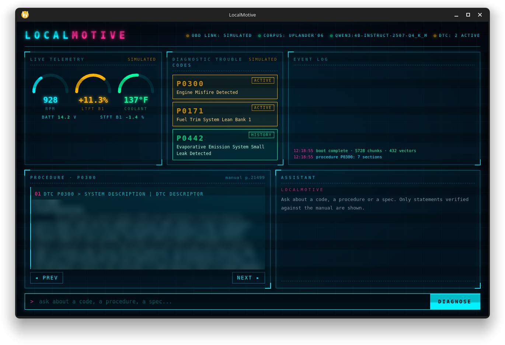

# LocalMotive

Offline repair assistant for one vehicle. It answers questions about a car
from its service manual, runs entirely on the owner's laptop (Ollama + SQLite),
and shows only statements that a deterministic verifier has checked against the
manual text.

First target: 2006 Chevrolet Uplander FWD 3.5L V6 (VIN code L), using an
offline copy of its service manual. The manual itself is **not** in this
repository.



## How a turn works

```
question ─► route ─► retrieve ─► draft ─► verify ─► answer
            regex    FTS5 BM25   local    every number/code
            DTCs,    + vectors   LLM,     must appear verbatim
            specs    (RRF),      JSON     in a cited chunk
                     exact DTC   schema
```

Each turn writes its stage files to `~/localmotive/sessions/<id>/turn-<n>/`:
`route.json`, `retrieved.json`, `draft.json`, `verified.json`, `answer.md`, `timings.json`.

* **Verified only.** The model answers as structured claims with chunk citations;
  any claim whose numbers, ranges, units or DTC codes are not exact substrings of a
  cited chunk is dropped (one retry with the reasons first).
* **OCR safety.** Spec tables that exist only as images are OCR'd. Each table row's
  metric and English values must agree by unit conversion; rows that don't are
  masked as `[see image]` so a misread torque can never be "verified". OCR-backed
  claims always show the source image.

## Crates

| crate | what it does |
|---|---|
| `lm-types` | shared types: `Chunk`, stage files, `Vehicle` |
| `lm-ingest` | manual HTML → `chunks.jsonl`; `compare` vs the reference; `ocr` (tesseract) with numeric fix + cross-check |
| `lm-index` | SQLite index: chunks, FTS5, exact-DTC table, sqlite-vec vectors; `embed` via Ollama |
| `lm-ollama` | small async client for a loopback-only Ollama (chat, streaming, JSON-schema format, embed) |
| `lm-retrieve` | regex router + synonyms, BM25/vector RRF retrieval, golden-set eval |
| `lm-verify` | deterministic claim verifier |
| `lm-pipeline` | one file-based turn; `lm` CLI (`ask`, `eval-e2e`) |
| `lm-app` | Tauri v2 desktop app: boot supervisor, dashboard, procedure walker, event log |

## Requirements

* Linux (developed on Ubuntu 26.04), Rust stable, `tesseract` (OCR step only)
* Tauri v2 deps: `libwebkit2gtk-4.1-dev libxdo-dev libayatana-appindicator3-dev librsvg2-dev`, `cargo install tauri-cli --version "^2"`
* Ollama with `qwen3:4b-instruct-2507-q4_K_M`, `qwen3:1.7b`, `qwen3-embedding:0.6b`

## Build and run

```bash
# 1. corpus (manual unzipped under ~/localmotive/corpus/…)
cargo run --release -p lm-ingest -- chunk
cargo run --release -p lm-ingest -- ocr
cargo run --release -p lm-index -- build
cargo run --release -p lm-index -- embed        # optional, ~3 h on a laptop CPU

# 2. command line
cargo run --release -p lm-pipeline --bin lm -- ask "P0300 misfire at idle"
cargo run --release -p lm-retrieve -- eval tests/golden.yaml

# 3. desktop app
cd crates/lm-app && cargo tauri build
../../target/release/lm-app
```

Per-machine files live outside the repo: `~/localmotive/vehicle.json` (VIN, engine)
and `~/localmotive/config.toml` (window/kiosk, answer preset; created on first run).

## Status

MVP. Telemetry and trouble codes in the app are **simulated** until an OBD-II
reader is added. On a Ryzen 5 7520U laptop an answer takes about 30 s; retrieval
recall@6 is 0.94 on the golden set and 0.90 on the held-out set (BM25 + synonyms).
